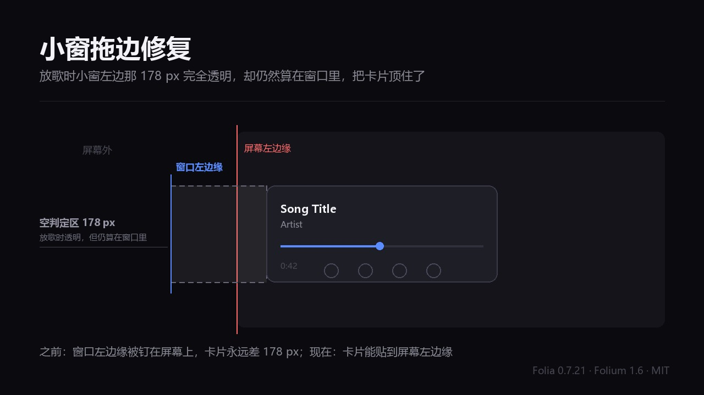

# 小窗拖边修复 / Remote Window Edge

Folia 的远程控制小窗是**虚大了一圈**的：窗口 602 × 184，而放歌时看得见的内容只有右边
420 × 176，剩下 182 px 完全透明，却照样算在窗口里。播放器按整个窗口限制拖动，于是这圈虚的
部分成了小窗真正的边界——看得见的卡片被顶在离屏幕左边缘 178 px 处，再也拖不动。

- 模组 id：`remote-window-edge`
- 版本：1.1.0
- 要求：Folia 0.7.21 及以上（`folia: ">=0.7.21 <0.8.0"`）
- 权限：`filesystem.data`（只用来存两个设置值）
- 作者：Hyacinth（[@miaowu104-gif](https://github.com/miaowu104-gif)）

## 它做什么

远程控制小窗本身是固定 602 × 184 的透明无边框窗口，里面那张卡片 594 × 176 居中，分两半：

- 右边 **420 px** 是放歌时真正看到的部分；
- 左边 **174 px** 是空闲时放大封面用的（「展开封面」打开时），**放歌时完全透明**。

也就是说，放歌时窗口比看得见的内容**大了一圈**：左边 178 px（4 px 边距 + 174 px 空闲封面区）
加上右边 4 px 边距，一共 182 px 是虚的——屏幕上什么也看不见，却仍然是窗口的一部分。

播放器的拖动限制按**整个窗口**算，要求窗口左边缘落在屏幕内。于是这圈虚的部分成了小窗真正的
边界：可见卡片永远离屏幕左边缘至少 178 px，再往左拖不动。

装上这个模组后，窗口可以比播放器允许的位置再往左 `额外往左拖出的像素`（默认 178），拖动时
可见卡片就正好能贴到屏幕左边缘。

## 安装

1. 下载或克隆本仓库；
2. 把整个目录放进 `%APPDATA%\Folia\mods\remote-window-edge`（或把仓库打成 zip 拖进「设置 → 模组」）；
3. 打开「模组系统」开关，启用「小窗拖边修复」，在确认窗口里同意。

模组改的是主进程行为：启用或「重载」后立即生效，已经打开的小窗也会被接管。

## 使用

「设置 → 模组 → 小窗拖边修复 → 小窗拖边」里有两项：

| 设置 | 默认 | 作用 |
| --- | --- | --- |
| 启用拖边修复 | 开 | 关掉后模组不再影响窗口的任何移动，完全回到播放器的行为 |
| 额外往左拖出的像素 | 178 | 比播放器允许的位置再往左多少；0 = 完全跟随播放器，420 = 最多 |

`178` 约等于左边那块透明区的宽度：**窗口左边缘到 −178 时，可见卡片左边缘正好在屏幕左边缘**。
想在放歌时让卡片再往左没入屏幕一点，把它调大。

命令面板里有「小窗拖边：状态」，显示开关、生效像素、挂上的窗口数和小窗数量。

## 工作原理（读什么、写什么）

播放器在 `electron/main.cjs` 里给远程控制窗口挂了一条 `will-move`
（`keepRemoteControlCoverOnScreen`）：窗口左边缘越出屏幕时 `preventDefault()`，再由
`clampRemoteControlWindowX` 把窗口挪回屏幕左边缘。

**模组不动这一条。** 它只做三件事：

1. 在同一个窗口上**追加**一条自己的 `will-move`，排在播放器那条之后；
2. 播放器拒绝这次移动、并把窗口挪到屏幕左边缘之后，如果用户拖到的位置更靠左、且在我们的
   范围内，再 `setContentBounds()` 一次，把窗口放回用户拖到的位置；
3. 停用时只 `removeListener` 掉自己那一条。

判断「播放器会让窗口停在哪」用的是 `screen.getDisplayMatching()`——它和播放器内部选屏的逻辑
是同一件事的官方 API，所以模组**既没有照抄播放器的算法，也没有写死 602 / 594 / 174**。
窗口是靠标题 `Folia Remote` 认出来的。

拖动时指针一定在窗口上，也就是卡片在用（空闲样式只在指针离开后才展开），所以拖动一律按
「还能再往左多少」这一个量判定，不需要知道当前是哪种样式。

读：

| 来源 | 用途 |
| --- | --- |
| `app.on("browser-window-created")` / `BrowserWindow.getAllWindows()` | 找到远程控制窗口 |
| `win.getTitle()` | 认出窗口，只读 |
| `screen.getDisplayMatching(bounds)` | 拖动时算播放器会让窗口停在哪 |
| `api.storage` 的 `enabled` / `overhang` | 读上次存的设置 |

写：

| 目标 | 内容 |
| --- | --- |
| `api.storage` / `folium.storage` 的 `enabled`、`overhang` | 一个布尔和一个 0–420 的整数 |
| `win.setContentBounds(...)` | 只在播放器拦下这次移动、而设置允许更靠左时，把窗口放回拖到的位置，同时保住内容尺寸 |

不写文件到别处、不发网络请求、不加载远程代码、不使用 `folium.internals`、不读播放状态。

## 为什么用 setContentBounds 而不是 setPosition

`win.setPosition()` 在缩放到 **150%** 的显示器上，每调用一次窗口的外框就宽一像素、高一像素。
小窗是无边框透明的，长出来的那一圈看不见，但仍然算在窗口里：指针落在那一圈上时播放器认为
「在窗口内」，鼠标点在那儿也会被窗口吃掉。拖得越多，虚的边越宽，最后整块判定框都比卡片大一圈。

`setContentBounds()` 带上 `getContentSize()` 读到的内容尺寸就没有这个偏移。内容尺寸是
页面被排版成的那一个，所以模组依然不需要知道 602 / 184 具体是多少——它只保证自己挪窗口的时候
不把这个尺寸动掉。

## 为什么不接管播放器的那条监听

1.0.0 的做法是 `removeAllListeners("will-move")` 再换成自己的。那有两个问题：

- 会把**别人**（其他模组、播放器以后加的）注册在同一个窗口上的 `will-move` 一起删掉；
- 停用时只能放回一份自己仿写的规则，不是播放器原来那条。播放器以后调整这条规则，
  停用过模组的用户就会一直沿用旧的仿写版本，直到重启。

现在改成追加 + 只摘自己：播放器的监听从头到尾没被碰过，所以「停用」就是真的什么都没有变，
不存在仿写和还原。

## 权限与数据访问

`permissions` 只有一项 `filesystem.data`，因为模组用 `folium.storage` / `api.storage` 存两个
设置值。它落在宿主本来就给每个模组准备的 `mods-data/remote-window-edge/` 里，与其他模组隔离。

要申报的非权限访问：

- **往窗口上追加一条 `will-move`**，并在里面读 `screen.getDisplayMatching()`、调 `setContentBounds()`。
  只针对标题为 `Folia Remote` 的那个窗口，只在播放器已经拦下这次移动时才动手。
  不删除、不修改任何已有的监听。

没有 `experimental`、没有 `embedOrigins`。

## 兼容性

- 在 **Folia 0.7.21（Folium 1.6）** 上开发。宿主 0.7.21 的 `app.asar` 里
  `remoteControlWindowGeometry.cjs`、`main.cjs` 的 `will-move` 实现已逐行核对。
- `folia: ">=0.7.21 <0.8.0"`：0.7.20（Folium 1.5）的远程控制窗口还是 428 px 宽、没有左边那块
  空闲封面区，数字不一样，所以不希望在那里加载。
- 只在 **Windows** 上起作用：播放器只在 `win32` 注册那条 `will-move`（别的平台的窗口管理器
  不允许拒绝移动，本来就能拖出屏幕）。其它平台上模组启动后什么都不做。
- 只用 `registries.settingsSections`、`registries.commands`、`folium.rpc`、`folium.storage`，
  不受 1.5 → 1.6 改名影响（`params` → `settings` 两种写法都兼容）。

## 已知限制

- **用到了不是公开接口的东西**：`will-move` 事件、窗口标题 `Folia Remote`、以及播放器「会拦下
  越出屏幕左边缘的移动」这个行为，都不在 Folium 接口里。播放器哪天改了这些，模组会**不起作用**
  （退回播放器原本的拖动行为），不会把窗口夹到错误的位置——它只在播放器已经拦下移动时才动手。
  重载一次模组后如果没变化，先看播放器是不是改了窗口标题。
- **空闲时展开的大封面可能被切**：播放器原本限制窗口左边缘，是为了让「展开封面」在空闲时
  放大显示的那块封面留在屏幕内。模组放开这条限制后，窗口停得越靠左，空闲时展开的封面被切得
  越多。放歌时不影响（那时那块是透明的）。不想要这个取舍就把「启用拖边修复」关掉。
  这也是为什么默认只放到「卡片贴到屏幕左边缘」，而不是更多。
- **默认值是与当前布局匹配的经验值**：178 来自现在这块透明区的宽度，不是一个能从播放器读出来
  的量。播放器改了窗口布局，用「额外往左拖出的像素」自己调。
- **已经胀大过的窗口不会自己缩回去**：模组挪窗口时用的是窗口**当前**的内容尺寸（它不知道
  602 × 184 这个数，也不该知道）。如果装上之前窗口已经被播放器撑大了，模组只会把它稳在那个
  大小、不再继续长。重启一次播放器就能回到正常尺寸。
- 设置改完对**已经打开的小窗**立刻生效（下一次拖动就用新值）；停用后已经被拖到屏幕外的窗口
  不会自动移回来。

## 卸载或恢复

在「设置 → 模组」里停用或删掉模组即可，它只摘掉自己追加的那条监听，播放器的行为原样保留。
要清掉存下来的设置，删掉 `%APPDATA%\Folia\mods-data\remote-window-edge\` 整个目录。

## 更新说明

### 1.1.0

- **不再接管宿主的 `will-move`**：一条都不删，只追加一条自己的，排在宿主那条之后；停用只摘掉自己这条，宿主的从头到尾没被碰过。
- **不再仿写宿主的规则**：上一版的 `restoreHostRule()` 放回去的是模组自己写的一份，宿主改了它就失效；现在没有「还原」这回事。
- **加了开关**：「启用拖边修复」（默认开）可整体关掉；「额外往左拖出的像素」0–420 可调，0 就完全跟随播放器。
- **不再硬编码 602 / 594 / 174**：窗口靠标题认，「宿主会让窗口停在哪」用 `screen.getDisplayMatching()` 算。
- **改用 `setContentBounds()`**：`setPosition()` 在 150% 缩放的显示器上每调用一次会让窗口外框长一像素，那一圈看不见却仍然算窗口，拖得越多判定框越大。

**这个修复同时在往 Folia 本体提 PR**（`folia-major` 的 `feat/remote-window-left-edge`）。如果宿主采纳了，模组就没有存在必要，届时会标记退役。**两边不要同时启用**——两条规则会叠加，窗口会被推到更左边。

## 许可证

MIT，见 [LICENSE](LICENSE)。
